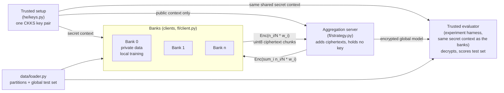

# Privacy-preserving federated fraud detection

Banks see only their own customers, so each one has few examples of fraud, and privacy rules stop them from
pooling transaction data. This project tests whether simulated banks can train a shared fraud model with
**federated learning** (FedAvg: each bank trains locally and sends only model weights), and whether adding
**homomorphic encryption** (CKKS) stops the aggregation server from seeing any bank's weights while giving the
same model. Three setups are compared on the same data and test set:

| mode | what is shared | who can read a bank's update |
|---|---|---|
| `local` | nothing: each bank trains alone | nobody |
| `fedavg` | plaintext model weights | the aggregation server |
| `fedavg_he` | CKKS-encrypted weights; the server only adds ciphertexts | only holders of the one shared secret key: the banks and the harness's evaluator |

We report detection quality (PR-AUC, and F1 at 0.5 and at a validation-tuned threshold), the cost of encryption
(time and bytes per round), a non-IID ablation and two attacks (label flipping by a bank, gradient inversion by
the server).

## Data and the three fraud views

The data is the Kaggle **IEEE-CIS Fraud Detection** dataset (590,540 card transactions, 3.5% fraud). It has a
single `isFraud` label and no labels for different kinds of fraud. Each "fraud type" in this project is
therefore a **feature view**: the same label, predicted from a different group of features. Each view is a
proxy for that kind of fraud, not a separately labelled task:

| `fraud_type` | features (input dim) | proxy for |
|---|---|---|
| `credit_card` | transaction amount, card/product categories, Vesta counts and time deltas (95) | card fraud |
| `account_takeover` | per-account behavioural history: activity counts, time since the previous transaction, new address/email/device (10) | account takeover |
| `identity_fraud` | identity and device fields (`id_*`, device, email domains) (109) | identity fraud |

The data is split by time (train 70% / validation 10% / test the latest 20%). The training rows are divided
into 3 or 5 **simulated banks** by card, with Dirichlet(alpha) label skew, so the banks differ in size and fraud
rate. Every mode and bank count is scored on the same global test set. Full details, numbers and caveats:
[data/DATA.md](data/DATA.md).

## Architecture



In `fedavg` the same flow carries plaintext float32 weights, and the server does Flower's sample-weighted FedAvg.

### One round of `fedavg_he`

1. **Downlink.** Each bank receives the global model. In round 1 this is the shared seeded initial model in
   plaintext; after that it is the encrypted aggregate, which the bank decrypts with the shared secret key.
2. **Local training.** Each bank trains for `local_epochs` epochs (Adam, BCE with `pos_weight` = its own
   negatives/positives).
3. **Scale and encrypt.** The bank multiplies its weights by its FedAvg weight **n_i / N** (its share of the
   training rows; all banks agree on the counts). It flattens them and encrypts them with CKKS in **chunks of
   4096 slots** (polynomial modulus 8192, scale 2^40). The serialized chunks are sent as 1-D uint8 arrays.
4. **Aggregate.** The server holds only the public context. It checks that every bank replied exactly once and
   **only adds** the ciphertexts. The sum is already the weighted average, because the banks pre-scaled their
   weights. A missing or duplicate bank aborts the round.
5. **Evaluate.** The server cannot evaluate an encrypted model. A **trusted evaluator in the harness** does it
   with the **same shared secret context the banks use** (not a separate key): it decrypts the global model,
   chooses the threshold on pooled validation predictions and scores the test set. In a deployment there would be
   no extra key holder: one of the banks would run this evaluation. It also records `max_weight_err`, the gap between the decrypted model and the
   plaintext weighted average of the same updates (about 1e-8).

The implementation drives Flower's own strategy, client manager and `NumPyClient` serialisation in one process
(no Ray), so parameters pass through the same `Parameters` encoding as over a network.

## Repository layout

| folder | owner | contents |
|---|---|---|
| `common/` | Pratham | experiment config, shared weight utilities, interfaces between data/models/fl/he |
| `data/` | Dhriti | IEEE-CIS preprocessing, feature views, bank partitioning, loader ([README](data/README.md), [DATA.md](data/DATA.md)) |
| `models/credit_card.py` | Uttam | credit-card MLP |
| `models/account_takeover.py` | Harshini | account-takeover MLP |
| `models/identity.py` | Likhitha | identity-fraud MLP |
| `fl/` | Jahnavi | Flower clients, strategies (FedAvg and encrypted FedAvg), simulation harness, metrics |
| `he/` | Anjan | CKKS context, encryption, keyless aggregation ([README](he/README.md)) |
| `experiments/` | Pratham | runner, grid (`run_all`), summaries, attacks, plots, `reproduce` |
| `results/` | Pratham | per-run CSVs, summaries, attack outputs, figures |
| `tests/` | | unit and integration tests on synthetic data |

`INTEGRATION.md` describes how `he/` is connected to `fl/`.

## Setup

Requires Python 3.12. Commands run from the repository root.

```bash
python3.12 -m venv .venv
source .venv/bin/activate
pip install -r requirements.txt --extra-index-url https://download.pytorch.org/whl/cpu
```

The extra index is needed for the pinned CPU-only PyTorch build (`torch==2.15.0+cpu`).

**Data.** Join the Kaggle competition
[IEEE-CIS Fraud Detection](https://www.kaggle.com/competitions/ieee-fraud-detection/data), accept its rules,
download `train_transaction.csv` and `train_identity.csv`, and put them in `data/raw/ieee/`. The first experiment
builds the processed federation automatically (about a minute per partition setting) in `data/processed/`.

> **Never commit data or keys.** `data/raw/`, `data/processed/` and `private_keys/` are in `.gitignore`. The
> Kaggle rules do not allow the data to be redistributed, so each member downloads their own copy. The same
> settings and seed always produce identical banks, so there is no need to share processed data.

## Reproduce everything

```bash
python -m experiments.reproduce            # full: grid (15 rounds, seeds 42 43 44), attacks, summaries, figures
python -m experiments.reproduce --quick    # small profile, about 15 minutes -> results/quick/
python -m experiments.reproduce --dry-run  # list the stages and what is already done, run nothing
```

`reproduce` runs `experiments.run_all`, then the two attack scripts, then `experiments.summarize` and
`experiments.plots.make_plots`, printing the time for each stage. Finished grid runs (one CSV per run) are
skipped, so an interrupted run can be restarted with the same command. The expected runtime is in the
`experiments/reproduce.py` docstring. Individual pieces:

```bash
python -m experiments.run_all [--quick] [--dry-run] [--attacks]   # main grid (+ optional attacks)
python -m experiments.attacks.label_flip [--quick]
python -m experiments.attacks.gradient_leakage [--quick]
python -m experiments.summarize --results-dir results
python -m experiments.plots.make_plots --results results --out results/figures
```

## Tests

```bash
python -m pytest data/tests -q                   # data pipeline (synthetic data)
python -m unittest discover -s tests -v          # common, fl, he, experiments, attacks, plots
```

Both run on generated IEEE-CIS-shaped data, so they do not need the Kaggle files.

## Where results land

| path | contents |
|---|---|
| `results/<fraud_type>_<mode>_b<banks>_a<alpha>_s<seed>.csv` | one row per round: test metrics at 0.5 and at the tuned threshold, validation metrics, timing and byte costs (`fl/metrics.py:ROW_KEYS`) |
| `results/summary_main.csv`, `summary_cost.csv`, `summary_noniid.csv` | final-round mean ± std over seeds; HE vs plaintext cost; alpha ablation |
| `results/attacks/` | `label_flip.csv`, `label_flip_summary.csv`, `gradient_leakage.csv`, `gradient_leakage_ciphertext_checks.csv` ([README](experiments/attacks/README.md)) |
| `results/figures/` | PNG (200 dpi) and PDF figures plus `index.md` with a computed takeaway for each |
| `results/quick/` | the same layout for `--quick` runs (not committed) |

## Limitations

* **In-process simulation.** All banks, the server and the evaluator run in one Python process, one after the
  other. There is no network, no separate processes and no real transport security, and the timings do not
  include network latency.
* **One shared secret key.** All banks, and the harness's evaluator, use the same CKKS secret context from a
  trusted setup. Encryption hides updates
  from the server only: any bank (or anyone with a bank's key) could decrypt another bank's update if it
  intercepted it. Multi-key or threshold HE, or secure aggregation, would remove this.
* **Honest-but-curious server only.** The server is assumed to follow the protocol. A malicious server
  (dropping, replaying or substituting ciphertexts, or sending a crafted model to one bank) is out of scope.
  Encryption also stops the server from inspecting updates, so poisoning defences that need plaintext updates
  are not available in `fedavg_he` (see the label-flipping experiment).
* **No dropout handling.** Every bank must reply every round. One missing bank aborts the round in both
  federated modes, because a partial ciphertext sum has no valid weighting.
* **Two threshold views.** F1 is reported at a fixed threshold of 0.5 and at a threshold tuned on pooled
  validation predictions (never on test). They can differ a lot, especially under class imbalance and attacks,
  so compare like with like. PR-AUC does not depend on a threshold and is the headline metric.
* **Data caveats** (details in [data/DATA.md](data/DATA.md), section 9). Banks are simulated from one dataset
  and `card1` is only a proxy for a customer. The encoder is fit on the pooled training split. The partition
  uses fraud labels from all splits. The split is by time, not by card, so test frauds can come from cards
  seen in training. Behavioural features depend on an approximate account key.
* **Identity coverage.** Only 24.4% of transactions have identity data, so the `identity_fraud` view is mostly
  missing-value indicators for the remaining rows.
* **Synthetic fraud types.** The three fraud types are feature views of one `isFraud` label, not separately
  labelled account-takeover or identity-fraud datasets.
* **Single dataset.** Everything is evaluated on IEEE-CIS only, with up to three seeds. Results may not carry
  over to other institutions, fraud mixes or real cross-bank distribution shifts.
